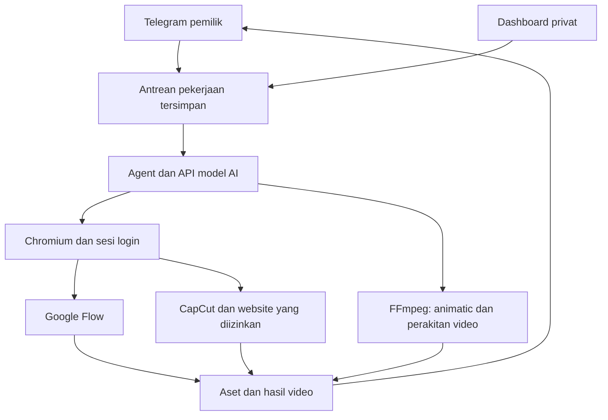

## Private Knowledge RAG + MCP (optional, Cloudbrowser v5)

Cloudbrowser now includes a gated **MCP Python SDK 2.3.0** client and an opt-in **local-only RAG worker**. RAG uses Docling, LlamaIndex Core, a local 384-dimensional embedding model, and PostgreSQL/pgvector. The core browser and Studio workflows remain independent of the knowledge services; startup does not silently download AI models or call external RAG providers.

- `rag_search`: retrieve source IDs, chunk IDs and SHA-256 evidence scoped to the active workflow project.
- `rag_ingest_artifact`: index an uploaded PDF/Markdown/text artifact after owner approval.
- `mcp_list_tools`: list explicitly allowlisted tools on an administrator-configured server.
- `mcp_readonly_call`: call an approved MCP read-only tool **only after owner approval**, preserving the action ledger for uncertain effects.

These are implemented interfaces and verified contracts; an actual offline embedding model and the RAG deployment are still required before live document retrieval works. No external MCP server is auto-installed, and no arbitrary MCP write tool is enabled.

Read **[Private RAG + MCP setup, security contract and acceptance evidence](docs/KNOWLEDGE_MCP.md)**. Use `docker compose -f compose.yaml -f compose.knowledge.yaml --profile knowledge up -d --build` only after provisioning a 384-d local model and the required secrets.

---

# Cloudbrowser A2A + Studio 0.4

Browser dan agent produksi video di server, dikendalikan melalui **Telegram** dan dashboard privat.
Studio/Godot kini terhubung dengan orchestrator dan editor A2A. PNG → mesh 2.5D → rig →
manifest → render dijalankan melalui layanan Studio, dengan pemeriksaan dan persetujuan pemilik.
**MorphGLB AI Studio v3.3.0** tersedia pada `/studio#morphglb`. Ekspor GLB/PNG/JSON dapat diimpor ke katalog aset Cloudbrowser; PNG dan GLB yang lolos pemeriksaan dapat dikirim ke Studio/Godot melalui job A2A dengan persetujuan mesh, rig, dan manifest. GLB yang membawa animasi tertanam atau rig tidak kompatibel ditolak. Lihat [STUDIO.md](docs/STUDIO.md) untuk batasan kualitas, keamanan, dan pengujian.
Mulai dengan `sh scripts/start_studio.sh`; lihat [STUDIO.md](docs/STUDIO.md) untuk konfigurasi,
panel editor, batas kemampuan dan pengujian. Statusnya integrasi teruji komponen; produksi penuh
dengan Blender/Godot pada server nyata masih memerlukan pengujian.
Saat pertama dijalankan, server meminta endpoint API, nama model, API key, bot Telegram,
identitas pemilik bot, dan password dashboard. Kredensial diisi di terminal server.

**Jika menerima paket ZIP:** ekstrak, masuk ke folder `Cloudbrowser`, lalu jalankan
`sh scripts/start.sh`. Instruksi `git clone` di bawah digunakan setelah kode tersedia di repositori.
Lihat [IMPORT_TO_GITHUB.md](docs/IMPORT_TO_GITHUB.md) untuk memasukkan paket ke repository yang sudah ada.



## Model membangun tim A2A

Versi 0.2 menambahkan pembuatan agent oleh model: penulis, operator browser, editor, dan reviewer.
Model menetapkan workflow dan dependensi, mendelegasikan tugas, lalu memeriksa bukti hasil.
Pekerjaan hanya berstatus selesai setelah langkah dan audit tujuan akhir lolos pemeriksaan.
A2A 1.0 JSON-RPC memakai SDK resmi; koneksi eksternal diaktifkan melalui `configure-a2a`.
Gunakan `/agents` dan `/workflow <job_id>` untuk melihat tim dan progres.

Lihat [A2A.md](docs/A2A.md) untuk alur, batas alat, konfigurasi, protokol dan bukti pengujian.

Versi 0.3 memperkuat pengambilan keputusan: aturan tindakan pada server, rekonsiliasi hasil yang
belum pasti, pemeriksaan ulang hash hasil, konteks proyek, pemilihan model per peran, batas keluaran
model, dan penghentian kegagalan berulang. Lihat [DECISIONS.md](docs/DECISIONS.md) untuk perubahan
mode auto, pemulihan, dan pengaturan model. Kesetaraan dengan ChatGPT Pro belum dibuktikan.

## Jalankan di server dengan Docker

Gunakan server Linux dengan Docker Engine dan Compose v2. Alokasi awal Compose:
2 CPU dan batas RAM 4 GB, termasuk Chromium dan FFmpeg; pekerjaan berat dapat memerlukan lebih.
Server tetap harus hidup untuk menerima Telegram. Polling Telegram memakai koneksi keluar;
bot tidak membutuhkan port masuk publik atau tunnel.

```bash
git clone https://github.com/StrategyG/Cloudbrowser.git
cd Cloudbrowser
sh scripts/start.sh
```

Perintah ini membangun image, membuka konfigurasi interaktif jika belum ada, lalu menjalankan server
di latar belakang. Konfigurasi pertama meminta:

1. **AI base URL** untuk API kompatibel Chat Completions, misalnya endpoint Qwen/DeepSeek
   atau server lokal llama.cpp/vLLM yang menyediakan `/chat/completions` dan tool calling.
   Gunakan base URL lengkap dari dokumentasi penyedia; tambahkan `/v1` jika disyaratkan penyedia.
2. **Nama model** yang tersedia pada endpoint tersebut. Model harus mendukung function/tool calling.
3. **API key** dengan input tersembunyi. Kosong diperbolehkan untuk server model lokal tanpa autentikasi.
4. **Vision y/n**: aktifkan hanya jika model menerima gambar. Kontrol koordinat/timeline AI memerlukan vision.
5. **Token bot Telegram** dari bot khusus yang dibuat melalui `@BotFather`.
6. **ID numerik pemilik**, atau kosong untuk pairing: terminal menampilkan kode, lalu kirim
   `/pair <kode>` ke bot melalui chat privat dalam tiga menit. Hanya akun pemilik yang diterima.
7. **Password dashboard** minimal 12 karakter.
8. Domain navigasi dan pilihan headless. Untuk Docker, pertahankan headless `n`;
   Xvfb menyediakan layar virtual untuk browser di server.

API key/token tidak diminta melalui chat Telegram atau halaman website. Konfigurasi berikutnya
menggunakan data yang tersimpan. Untuk mengubahnya, hentikan server terlebih dahulu:

```bash
docker compose stop
docker compose run --rm cloudbrowser configure
docker compose up -d
```

Dashboard di komputer server: **http://127.0.0.1:8000**. Untuk server jarak jauh, gunakan SSH:

```bash
ssh -L 8000:127.0.0.1:8000 USER@SERVER
```

Kemudian buka http://127.0.0.1:8000 di perangkat dengan koneksi SSH tersebut.
Untuk akses lewat HP tanpa SSH, lihat pengaturan HTTPS di [DEPLOYMENT.md](docs/DEPLOYMENT.md).

```bash
docker compose logs -f
docker compose ps
docker compose run --rm cloudbrowser doctor
```

`doctor --live` memeriksa Telegram dan membuat **satu permintaan kecil ke API AI**;
perintah itu memakai kuota API yang dikonfigurasi.

## Menggunakan Telegram

Setelah server berjalan, buka bot lalu kirim `/start`. Pesan lama yang menunggu sebelum aktivasi
instalasi pertama diabaikan. Kirim instruksi biasa, contohnya:

```text
Buat naskah video ARUSIA 30 detik dengan 4 adegan, lalu simpan prompt tiap adegan.
Buka Google Flow dan siapkan prompt untuk klip pertama. Tunggu saya login jika diperlukan.
Gabungkan klip yang sudah diunduh menjadi MP4 1280x720 30 fps dan kirim hasilnya.
Buat animatic kartu storyboard 4 adegan untuk meninjau urutan cerita.
```

Unggah video/audio/dokumen melalui Telegram; caption menjadi instruksi pekerjaan.
Untuk file besar, gunakan unggahan dashboard.

| Perintah | Fungsi |
| --- | --- |
| `/run <pekerjaan>` | Pekerjaan baru; teks biasa juga diterima |
| `/flow`, `/capcut` | Minta agent membuka website |
| `/status` | Model, mode, status dan ID pekerjaan |
| `/agents`, `/workflow <job_id>` | Tim A2A, tugas dan hasil pemeriksaan |
| `/screen` | Kirim tangkapan layar browser ke pemilik |
| `/files`, `/get <artifact_id>` | Daftar file dan ambil hasil |
| `/approve <id>`, `/reject <id>` | Tanggapi permintaan tindakan; tombol Telegram juga tersedia |
| `/stop [job_id]` | Batalkan job aktif atau job dalam antrean |
| `/resume <job_id> [arahan]` | Lanjutkan berdasarkan kondisi browser terbaru |
| `/project <nama>` | Pilih konteks proyek, misalnya `arusia` |
| `/brief <catatan>` | Simpan arahan tetap proyek; `/brief -` menghapusnya |
| `/resolve_action <id> applied\|not_applied` | Catat hasil setelah memeriksa website/peer |
| `/mode approve` | Persetujuan untuk klik, pengetikan, pemilihan opsi, drag dan unggah AI |
| `/mode auto` | Otomatis untuk persiapan; tindakan akun tetap mengikuti aturan server |

Mode awal adalah `approve`. Ganti mode ketika tidak ada job aktif. Sejak versi 0.3, klik, unggah,
keyboard, drag, dan delegasi remote memerlukan persetujuan pada kedua mode. Hanya fill/select yang
bisa diizinkan otomatis melalui konfigurasi terminal pemilik. Tindakan website yang tidak diketahui
efeknya diperlakukan sebagai tindakan yang perlu ditinjau.

Pilih proyek sebelum mengirim tugas, lalu simpan aturan yang perlu dipakai kembali:

```text
/project arusia
/brief Lima sahabat: Kio, Lumi, Arka, Mayor, RUX. Simpan naskah dan hasil QC.
/run Buat naskah episode pendek tentang kerja sama di Garasi RUX.
```

Dashboard juga menyediakan konteks proyek, progres langkah/review, pemakaian model, dan pemeriksaan
hasil tindakan. Memori proyek memisahkan konteks percakapan; profil browser dan daftar aset tetap
milik satu pemilik, bukan ruang kerja terpisah untuk banyak pengguna.

## Google Flow, CapCut dan login

Agent menggunakan kontrol website yang benar-benar terlihat. Tidak ada endpoint generasi Flow/CapCut
buatan atau klaim bahwa akses akun sudah tersedia. Ketika login, OTP, CAPTCHA, atau informasi tambahan
diperlukan, agent berhenti pada status `waiting_user`:

1. Masuk ke dashboard, aktifkan **Layar langsung**.
2. Klik tampilan browser, gunakan kolom **Ketik** dan tombol keyboard untuk login.
   Kolom pengetikan dashboard disamarkan dan tidak disimpan di log tindakan.
3. Pilih tab lain jika login membuka popup. Gunakan mode geser untuk pekerjaan manual pada timeline.
4. Balas di Telegram setelah selesai, atau gunakan `/resume <job_id>`.

Sesi browser disimpan pada profil privat di server. Model teks dapat mengoperasikan elemen DOM;
editor canvas/timeline lebih sesuai dengan model vision atau kontrol manual.
CAPTCHA, penolakan login browser otomatis, native file picker, dialog browser dan kebijakan website
dapat memerlukan bantuan operator. Dialog JavaScript native di-dismiss; modal HTML tetap dapat dioperasikan.
Perubahan antarmuka website dapat memerlukan langkah manual. Keberhasilan render/export pada kedua
layanan harus diuji dengan akun dan kuota yang akan dipakai.

## Produksi CPU-only di GitHub Codespaces (tanpa GPU)

Tool `render_cpu_shot` merender MP4 berdurasi 1–15 detik dari PNG latar dan
1–8 pose PNG transparan. FFmpeg membuat animasi sprite/pose sederhana tanpa GPU,
dengan cache SHA-256 untuk menghindari rendering ulang yang identik. Tool ini
tersedia bagi orchestrator dan agent editor, dan hasilnya dapat dirakit melalui
`compose_video`. Ini bukan generator 3D atau sistem lip-sync/IK; inspeksi visual
masih wajib. **Lihat [panduan Codespaces CPU-only](docs/CODESPACES_CPU_VIDEO.md)**
untuk instalasi, batas sumber daya, tes MP4 nyata dan workflow ARUSIA.

## Hasil dan produksi video

- Naskah, shot list, prompt, JSON, subtitle SRT/VTT dapat disimpan sebagai file.
- File yang diunduh browser disalin ke daftar aset persisten.
- `compose_video` merakit 1–20 klip atau gambar menjadi MP4, maksimum 120 detik per klip,
  total 20 menit, sampai 1920×1080 atau 1080×1920, pilihan 24/25/30/60 fps.
- Gambar diam tampil 5 detik. Audio asli klip diganti dengan track audio yang dipilih;
  tanpa track audio, hasil perakitan hening. Subtitle SRT dapat dibakar ke video.
- `render_storyboard` menghasilkan **MP4 kartu storyboard/animatic**, untuk meninjau urutan adegan.
  Animasi karakter dan video generatif dibuat melalui layanan/model yang sesuai.
- Batas file server 100 MB per file secara default. File bot Telegram mengikuti batas layanan:
  unduhan masuk sampai 20 MB dan unggahan dokumen bot sampai 50 MB. Hasil besar tersedia di dashboard.

Alur ini adalah agent mandiri. Kemampuannya mengikuti model API, alat yang tersedia, dan akses akun.
ChatGPT Plus dan penagihan OpenAI API terpisah; kuota Google Flow/CapCut mengikuti masing-masing layanan.

## Menjalankan tanpa Docker

Python 3.11+, FFmpeg, font DejaVu, dan browser Playwright diperlukan.
Untuk Linux server, instal Xvfb/xauth dari package manager OS. Jalankan sebagai user biasa.

```bash
python3 -m venv .venv
. .venv/bin/activate
python -m pip install -r requirements.lock -e .
python -m playwright install --with-deps chromium
python -m cloudbrowser configure
xvfb-run -a -s '-screen 0 1280x720x24 -nolisten tcp' python -m cloudbrowser
```

Server model Qwen lokal dapat berjalan sebagai proses terpisah melalui llama.cpp/vLLM;
Ollama tidak diwajibkan. Gunakan model dan parser yang mendukung tool calling.
Di Docker, `http://host.docker.internal:PORT/v1` menunjuk server AI lokal pada host.
API key tidak diperlukan jika endpoint lokal tersebut memang tidak memakai autentikasi.

## Verifikasi dan status

```bash
python -m pip install -r requirements.lock -e '.[dev]'
python -m ruff check .
python -m pytest -q
python -m playwright install chromium
CLOUDBROWSER_TEST_BROWSER=1 python -m pytest -q
```

Pengujian mencakup autentikasi/CSRF, pembatasan pemilik Telegram, callback, deduplikasi,
persetujuan sekali pakai, penghentian/pemulihan, pembatasan URL privat, HTTP model kompatibel,
serta MP4 nyata melalui FFmpeg. Tes Chromium memerlukan binary browser dan flag di atas;
GitHub Actions juga menjalankan build Docker dan smoke test Chromium dengan sandbox.

Lihat [VALIDATION.md](docs/VALIDATION.md) untuk bukti dan batas verifikasi yang sudah dilakukan,
[ARCHITECTURE.md](docs/ARCHITECTURE.md) untuk struktur kode, dan
[SECURITY.md](SECURITY.md) untuk batas akses serta penyimpanan data.

## Referensi API

- [Playwright persistent context](https://playwright.dev/python/docs/api/class-browsertype#browser-type-launch-persistent-context)
- [Playwright downloads](https://playwright.dev/python/docs/downloads)
- [Playwright Docker dan sandbox](https://playwright.dev/python/docs/docker)
- [Telegram Bot API](https://core.telegram.org/bots/api)
- [DeepSeek tool calling](https://api-docs.deepseek.com/guides/tool_calls/)
- [Qwen/vLLM deployment](https://qwen.readthedocs.io/en/stable/deployment/vllm.html)
- [Penagihan ChatGPT dan OpenAI API](https://help.openai.com/en/articles/9039756-managing-billing-for-chatgpt-and-the-api-platform)
