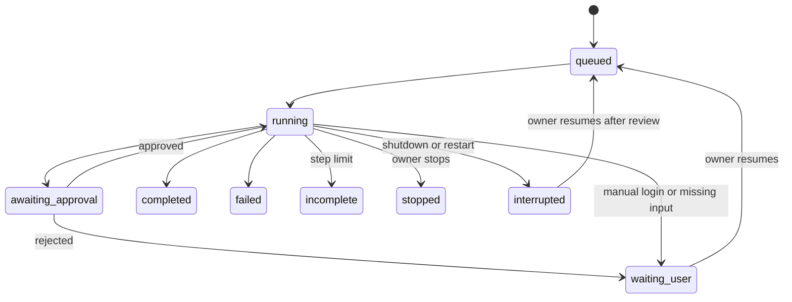

# Architecture

Single-owner, single-worker service. Telegram long polling and FastAPI share one asyncio runtime;
a single browser profile is controlled by a serialized queue. No LLM runs inside the Chromium process:
the agent on the server calls a configured AI API, observes Chromium and executes typed tools.

| Module | Responsibility |
| --- | --- |
| `config.py`, `__main__.py` | First-run wizard, optional Telegram pairing, secret storage, CLI |
| `telegram.py` | Bot API transport, owner checks, commands, uploads and result delivery |
| `llm.py` | Chat Completions HTTP client, tool-call validation, bounded API retries |
| `agent.py` | Model/tool loop, queue, approvals, cancellation and user handoff |
| `tools.py` | JSON schemas plus runtime validation for every model tool |
| `browser.py` | Persistent Chromium, DOM observations, screenshots, actions, downloads |
| `network.py` | Public-web URL checks, navigation allowlist, private address rejection |
| `store.py` | SQLite/WAL jobs, messages, events, approvals, artifacts, polling cursor |
| `artifacts.py`, `media.py` | File IDs, bounded uploads, FFmpeg/FFprobe and animatic rendering |
| `web.py`, `static/` | Password/session auth, CSRF, browser control and creator dashboard |
| `policy.py`, `errors.py` | Server-controlled action approvals and explicit pre-dispatch failures |

## Job transitions

The worker holds a control lease during a job. Manual dashboard actions are available after the
job yields for user input or is stopped. Screenshots remain readable during jobs.
Only one process may own a data directory; the process lock prevents two bot pollers/browser workers.

## Recovery and idempotency

Telegram job creation is keyed by update ID; the durable polling cursor advances after dispatch.
Resumed messages carry a dedupe key. Approvals use an atomic conditional status transition and
an in-memory future; a duplicate callback cannot execute an action again.

Running/queued/awaiting-approval jobs become `interrupted` on recovery. Old approvals expire.
Unfinished tool calls receive an interrupted result in conversation history and are never replayed
automatically. Resume obtains a new page observation. A web action can succeed immediately before
a crash, so **exactly-once effects on third-party websites cannot be guaranteed**. Human review of
the browser and provider history is required before repeating uncertain generation/export steps.

## Model and browser observations

Chat Completions provides function/tool calls. Tool arguments pass Pydantic validation;
there is no arbitrary code/eval/shell tool. Playwright uses a fixed, repository-owned observation script.
The model receives a bounded page-text excerpt and IDs for up to 100 interactive elements in the
main document/open shadow DOM. Cross-origin iframes/canvas require current screenshots and vision,
or manual operation. The viewport is 1280×720.

Element actions must use the latest snapshot token. A changed URL, label, input type, destination
or disabled state invalidates the action before it is executed. This reduces stale-target mistakes;
it does not prove a website's behavior or eliminate prompt injection. Vision images are sent only
when enabled and are not retained as base64 blobs in job history. Recent complete tool groups are
retained within a bounded model context.

## Video tools

FFmpeg/FFprobe run as subprocesses with fixed argument lists and `shell=False` semantics.
Uploaded media are assigned server-generated file IDs. Media demuxers are chosen from a fixed
extension map, and input protocols are restricted to `file,pipe`. User-supplied manifests or URLs
are not passed to FFmpeg. Render cancellation terminates child processes.

The implementation produces scripts, prompts, subtitles, actual storyboard MP4s and assembled
clips. Generative model quality, character consistency, Flow credits and CapCut project format
remain properties of the selected services and assets.

## A2A 0.2 extension

`crew.py` and `crew_models.py` add model-created scoped agents, a frozen dependency graph,
independent step reviews and a final audit against the original goal. `verification.py` validates
actual file integrity and declared video properties. `a2a_server.py` binds the official SDK 1.0
JSON-RPC routes to durable jobs; `a2a_peer.py` delegates to admin-configured remote agents and
retains uncertain send outcomes without replay. All roles share the parent model-call budget.

The parent holds the single browser lease while local specialist calls run inline, so local
agent-to-agent delegation cannot deadlock behind the parent's queue entry. A specialist human
handoff propagates to the parent, then the lease is released. External direct specialist tasks
return their scoped output for caller review; only the orchestrator's completed workflow has a
passed final goal audit. See `A2A.md` for exact protocol/capability boundaries.

## Decision workflow 0.3

Every role receives the original goal, project brief, frozen plan, latest task/review state, and
budget on each model request. This state is rebuilt from SQLite and survives history trimming.
Owner-selected per-role model names use the same configured API endpoint and capability profiles.

All parent and specialist mutations pass one server policy. Exact argument hashes and state
transitions are committed before dispatch. Timeout/cancellation after dispatch creates an unknown
effect; further external mutations wait for owner reconciliation. Pre-dispatch stale-target
errors are canceled rather than treated as completed actions. There is no exactly-once guarantee
for third-party websites.

Passed file reviews are rechecked by current SHA-256/size before dependency execution and final
completion, including after the final model audit. Browser reviews include current origin/text
checks and screenshots when vision is enabled. Identical reviewed delegations reuse their output.
Repeated identical tool errors yield to the owner instead of consuming the full step budget.

SQLite migration adds a default project to old jobs without replacing job history. External A2A
context IDs are mapped to reserved project names. Output-token reservations and call counts persist
across restart/resume; missing provider usage retains the full reservation. See `DECISIONS.md`.
