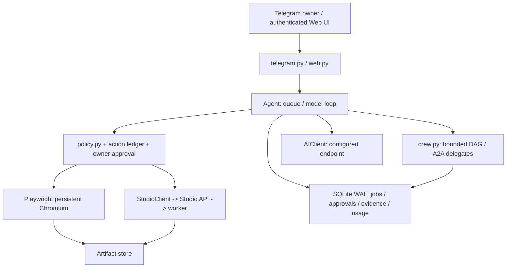
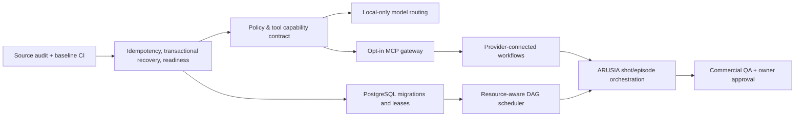

# Cloudbrowser v5.0 — Architecture Intelligence Audit

**Audit date:** 2026-10-30  
**Repository:** `StrategyG/Cloudbrowser`; audited baseline: `main` at the beginning of the v5 P0 branch.  
**Method:** GitHub recursive tree, source inspection, existing test source and GitHub Actions metadata. No private server, live Telegram credentials, external AI account or production browser session was available to this audit.

## Executive assessment

Cloudbrowser is a **working single-owner, single-browser-worker prototype/early operational service**, not yet the seven-layer, multi-tenant autonomous OS described by v5.0. Its strongest reusable foundations are typed tool calls, explicit owner action approval, persistent SQLite/WAL jobs, scoped A2A delegation with review, Chromium/Playwright, Telegram/Web UI, and a review-gated MorphGLB → Studio → Blender/Godot → FFmpeg path. **Do not replace these working paths solely to adopt new terminology.**

### Runtime map (source evidence)

| Responsibility | Evidence in repository | Current limit |
| --- | --- | --- |
| Entry point, configuration and process | `cloudbrowser/__main__.py`, `config.py`, `process_lock.py`, `scripts/entrypoint.sh` | Single server and data directory; interactive configuration |
| Telegram gateway | `telegram.py` (Bot API polling, private owner check, command dispatch) | One configured owner; v5 command vocabulary not fully mapped |
| Web/API gateway | `web.py`, `static/app.js`, `static/index.html` | Password/session/CSRF; not multi-user RBAC or WebSocket subscriptions |
| Model interaction | `llm.py` (`AIClient.complete`), `config.py` (`ai_base_url`, `ai_model`, `role_models`) | One configured Chat Completions-compatible endpoint, no general provider health/capability router |
| Supervisor/tool loop | `agent.py` (`Agent._run`, `_checked_tool`), `policy.py`, `tools.py` | Model-proposed steps; policy gate protects marked mutating tools |
| DAG and A2A | `crew.py`, `crew_models.py`, `a2a_server.py`, `a2a_peer.py` | Typed ordered DAG max 8 steps; local specialists share one parent browser lease |
| Browser | `browser.py`, `network.py` | Persistent single Playwright Chromium profile; DOM/snapshot and viewport action support |
| Durable state | `store.py` | SQLite WAL and recovery; **not** PostgreSQL/Temporal or generalized distributed scheduler |
| QA | `verification.py`, `tests/test_decisions.py`, `tests/test_crew.py` | File checks plus some browser checks; not independent visual/semantic truth |
| Studio assets | `cloudbrowser/morphglb/`, `studio_client.py`, `services/studio_v4/` | Authenticated iframe/asset handoff; one-character, bounded GLB/PNG to Godot |
| Deployment and verification | `Dockerfile`, `compose*.yaml`, `.github/workflows/ci.yml`, `docs/DEPLOYMENT.md` | Local/Compose; no observed high-availability production deployment |

### Current execution paths

## Findings and gaps

Each entry includes **severity, evidence, impact, fix and verification method**. Severity describes risk relative to the v5.0 target, not a claim that a vulnerability has been exploited.

| ID | Severity | Evidence | Impact | Recommended fix | Verification |
| --- | --- | --- | --- | --- | --- |
| A-01 | HIGH | `store.py` uses SQLite/WAL; `agent.py` single queue/lease | Multi-node workers, row leases, global scheduling and HA are not supported | Introduce an opt-in PostgreSQL repository interface and explicit migration plan **before** enabling >1 worker | Concurrent-worker lease test, migration/rollback, forced crash |
| A-02 | HIGH | `browser.py` `launch_persistent_context` with one `browser-profile`; `telegram.py` one owner | No isolation between multiple users | Keep single-owner restriction; multi-user requires separate context, artifact namespace and authorization | Two-principal cookie/storage/file isolation tests |
| A-03 | HIGH | `llm.py` one `/chat/completions` endpoint; `role_models` only changes model ID | Qwen GGUF can work through compatible local HTTP server, but provider capability discovery/routing and privacy-bound fallback not available | Add explicit adapter/capability registry, local-only policy, no silent external fallback | Local unreachable/no-cloud-egress tests; provider contract tests |
| A-04 | HIGH | No generic MCP client/registry module in recursive tree; A2A peer is a different protocol | Dynamic MCP tools cannot be assumed available | Add opt-in, allowlisted MCP client with signed policy contracts, bounded schemas and transport version pinning | Read-only MCP mock contract; denied destructive action; remote error |
| A-05 | MEDIUM | `crew_models.Workflow` validates unique IDs and earlier dependencies; `crew.py` delegates inline | DAG exists, but no resource-aware parallel scheduler or generalized checkpoints | Extend workflow contract and resource locking incrementally, preserve existing sequential behavior | Competing task resource-lock and cancellation tests |
| A-06 | HIGH | `store.py` previously deduplicated only on global `request_key` | A reused key could return a different project or goal | **P0 patch:** bind key to exact goal and project in one DB transaction; web API accepts optional idempotency key | `tests/test_v5_p0.py`; repeated/conflicting requests across restart |
| A-07 | MEDIUM | `store.recover` maintained multiple state tables; `agent.start` calls recovery | Partial restart reconciliation could make approval/action states inconsistent | **P0 patch:** atomic recovery transaction; unknown external effects stay unresolved | Injected SQLite trigger/rollback test |
| A-08 | MEDIUM | `web.py` old `readyz` mainly checked Telegram; worker and DB not included | Proxy could route to instance without active queue worker | **P0 patch:** inspect DB, worker and Telegram and return 503 when not ready | `tests/test_v5_p0.py`; live Compose readiness probe |
| A-09 | HIGH | `services/studio_v4/studio/manifest.py` duration/frame ceiling; `godot_render.py` one character | A 12-minute ARUSIA episode is not directly executable as one Studio job | Introduce shot-level renders, episode orchestration/FFmpeg composition and resume checkpoints | Real 12-minute shot sequence with per-shot QA and evidence |
| A-10 | MEDIUM | `verification.py` and `services/studio_v4/studio/gltf_qa.py` report deterministic checks | No proven foot contact, semantic continuity, animation aesthetic quality or professional rig fitting | Human visual approval plus repeatable scene-level tests; add motion metrics later | Real ARUSIA character + multiple cameras, ground-contact measurements |
| A-11 | MEDIUM | `telegram.py` supports `/run`, `/stop`, `/resume`, `/agents`; not all v5 commands | v5 command contract is only partly exposed | Add backward-compatible aliases once status/pause semantics are defined | Authenticated Telegram command regression tests |
| A-12 | MEDIUM | `store.py` events/action ledger, `web.py` health; no OpenTelemetry/Prometheus module in tree | Cross-service observability and resource trends limited | Add correlation IDs and redacted structured logs/metrics without changing policy trust boundaries | Event tracing across gateway/worker and secret scan |

## Concrete boundary contracts

- **Gateway → Agent:** input goal, optional validated project slug and optional scoped idempotency key; result persisted job ID/status. Duplicate key with changed content is rejected.
- **Agent → Policy:** only tool schemas from `TOOL_MAP`, validated arguments and server-configured policy; model response is a proposal, not an authorization.
- **Policy → Executor:** prepare pending action in DB, obtain owner approval when required, transition to applying before external dispatch, reconcile unknown outcomes after crash. There is no general exactly-once guarantee on third-party websites.
- **Agent → Crew:** `Workflow`/steps validated by Pydantic; child calls are scoped to `PROFILES`; output proof must survive hash/integrity validation.
- **Studio/Cloudbrowser:** binary artifacts by registry ID, scoped Studio API token, human mesh/rig/manifest approvals; external GLB with incompatible rig must fail closed.

## Delivery dependency graph

**Audit status:** source-verified architecture and code changes described separately. Successful CI is **not** equivalent to real Telegram-provider, external MCP, multi-user, or 12-minute episode acceptance. See `SECURITY_AUDIT.md`, `PRODUCTION_READINESS.md` and `UPGRADE_ROADMAP.md`.

---

## 2026-10-30 P0 lifecycle-control delta (branch: `feat/v5-p0-lifecycle-control`)

| Finding | Severity | Source evidence | Impact | Implemented mitigation | Verification |
| --- | --- | --- | --- | --- | --- |
| V5-LC-01: operator pause/cancel absent as distinct states | HIGH | Baseline `agent.py` only offered resumable `stop`; `telegram.py` only exposed `/stop` | Cannot distinguish temporary pause from terminal cancellation | Explicit `paused` and `cancelled` outcomes; `Agent._interrupt` and persistent job state; requeue only on intentional resume | `python -m pytest -q tests/test_v5_lifecycle.py` |
| V5-LC-02: terminal job may be overwritten by stop | HIGH | Baseline `Agent.stop` directly wrote `stopped` to any non-active job, including completed | Corrupts recorded completion / allows unauthorized continuation | Terminal guard rejects completed/cancelled jobs; duplicate same-intent requests return unchanged state | Tests in `tests/test_v5_lifecycle.py` |
| V5-LC-03: no lifecycle API / Telegram parity | MEDIUM | `web.py` exposed `/stop` only; `telegram.py` lacked `/pause`, `/cancel`, `/tasks`, `/health` | Operators could not safely manage workflows from both gateways | Session + CSRF-protected API routes, private-owner Telegram commands, audit events and dialog buttons | `tests/test_telegram.py`, `tests/test_v5_lifecycle.py`, Chromium smoke |
| V5-LC-04: interruption of uncertain external effects | HIGH | `_checked_tool` already writes `unknown` action ledger on cancellation after applying | Replaying effect may duplicate an external mutation | Preserve prior reconciliation barrier; cancellation never auto-resubmits an uncertain mutation | `tests/test_decisions.py` and new lifecycle tests |

This increment **does not** introduce a new DAG planner, autonomous code execution, PostgreSQL migration, MCP fabric, multi-user isolation, full model router, or 12-minute ARUSIA rendering. The existing single-owner architecture remains the supported deployment boundary.
