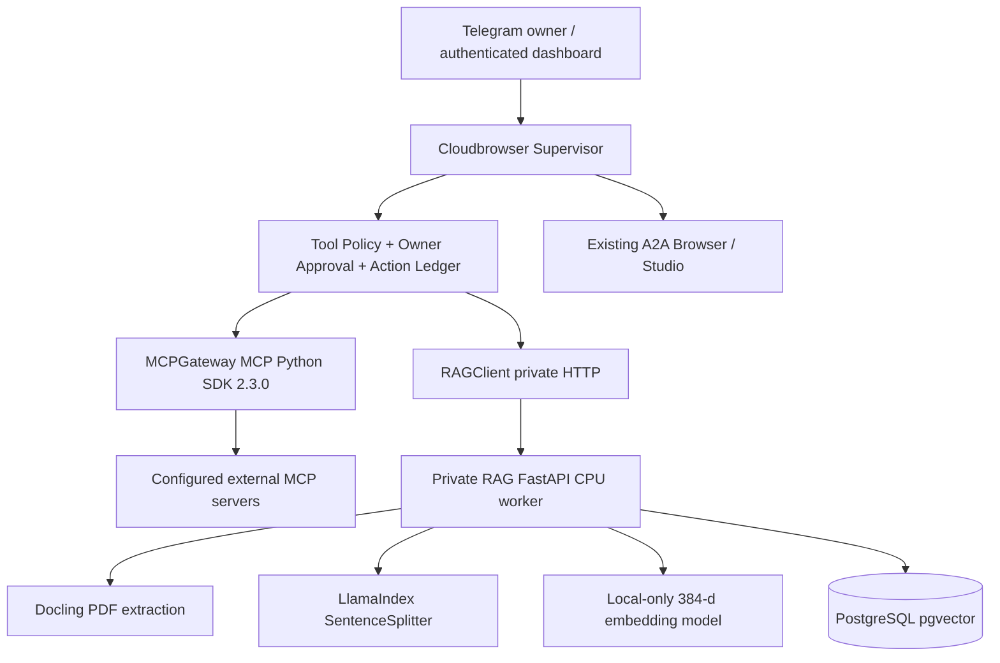

# Cloudbrowser v5 — Private RAG and MCP Tool Fabric (incremental)

**Implementation scope:** opt-in RAG + administratively allowlisted MCP 2.x client. This does **not** implement a general MCP federation service, autonomous ingestion from Dropbox/Drive, full semantic memory, or a production-grade multi-tenant knowledge platform.

## Architecture



No RAG or MCP server is exposed to the model unless configured. RAG and MCP tool responses are **untrusted data**, not instructions. Only existing registered artifacts may be indexed. Requests are scoped to the job's project. Remote MCP calls are owner-approved even for admin-declared read tools; a server-provided annotation alone is not a reliable security boundary.

## Components

- `cloudbrowser/rag_client.py`: private bearer-token adapter, client-side validation of project IDs and evidence.
- `cloudbrowser/mcp_gateway.py`: official MCP SDK v2.3.0, Streamable HTTP, explicit server and tool allowlists, JSON Schema argument validation, response budget, no model-controlled URL.
- `cloudbrowser/tools.py`: `rag_search` (read), `rag_ingest_artifact` (approval), `mcp_list_tools` (read), `mcp_readonly_call` (approval).
- `services/rag_v1/app.py`: Docling PDF extraction, LlamaIndex text chunking, 384-d local embedding, source SHA-256, pgvector cosine retrieval and project isolation.
- `compose.knowledge.yaml`: opt-in private RAG and database. No host-mapped ports for either service.
- The existing SQLite store continues to own job state, approvals, action reconciliation and A2A. PostgreSQL is **only** used by the optional RAG service.

## Operator setup

1. Keep `Cloudbrowser` as a **single-owner service**. Create a dedicated private 384-dimensional SentenceTransformer embedding model directory (for example, the local files for `sentence-transformers/paraphrase-multilingual-MiniLM-L12-v2`). Do this manually with an approved network and verify licensing. The RAG process sets `HF_HUB_OFFLINE=1` and will **not** automatically retrieve model weights.
2. Configure environment variables in a secure server environment, **not in Telegram**:

   ```bash
   export RAG_API_TOKEN="$(openssl rand -hex 32)"
   export RAG_DB_PASSWORD="$(openssl rand -hex 32)"
   export RAG_EMBEDDING_DIR="$HOME/models/paraphrase-multilingual-MiniLM-L12-v2"
   export RAG_MODEL_REVISION="multilingual-minilm-l12-v2-local"
   test -f "$RAG_EMBEDDING_DIR/config.json"
   docker compose -f compose.yaml -f compose.knowledge.yaml --profile knowledge config -q
   docker compose -f compose.yaml -f compose.knowledge.yaml --profile knowledge up -d --build
   ```

3. The Compose override supplies `CLOUDBROWSER_RAG_URL=http://rag-api:8090` and `CLOUDBROWSER_RAG_TOKEN` to Cloudbrowser. Cloudbrowser validates this private origin at startup. No password is placed in a model prompt.
4. Upload a PDF, MD or TXT to the existing Cloudbrowser dashboard. Ask the Supervisor to index its **artifact ID** using `rag_ingest_artifact`; inspect and approve. Then use `rag_search` with a specific question. A result carries `project_id`, `source_id`, `chunk_id`, SHA-256 and a cosine score. Scores are similarity estimates, not confidence or factual verification.
5. When changing embedding weights, update `RAG_MODEL_REVISION` and reindex. Old chunks are excluded by revision. Plan database backup/restore and capacity limits before collecting private material.

**PDF limitations:** Docling can run OCR when local model assets are installed and compatible; the default Docker configuration does not provision OCR weights. The initial response provides document/chunk provenance but **not guaranteed exact page citations**. The PDF may be scanned or conversion may fail offline. Do not claim successful ingestion until `indexed: true` and `chunk_count` are returned.

## MCP setup

For an approved MCP Streamable HTTP server, add an administrator-authored entry in the **private** `/data/config.json` (never commit a token):

```json
{
  "mcp_servers": [
    {
      "id": "internal_docs",
      "url": "https://your-private-mcp.example/mcp",
      "read_tools": ["search_documents"],
      "api_token": "configured-on-server-only"
    }
  ]
}
```

This snippet shows only the new field; keep other required config fields. `api_token` may be omitted for a server that needs no auth; remote sensitive servers should require strong authentication. `http://` is accepted only for explicit loopback hosts; other endpoints require HTTPS. The owner must verify MCP tool semantics (read-only) before allowlisting. A discovered tool **cannot** grant itself permissions, and all remote requests use the recorded approval/action ledger.

**Important:** Enabling the MCP SDK installs a client, **not** IBM ContextForge, GitHub MCP Server, Playwright MCP Server, or Docling MCP automatically. Those are separate servers, each requiring an operator deployment and security review. No automatic write tool is enabled.

## Test evidence and remaining gates

- `python -m pytest -q tests/test_knowledge_mcp.py tests/test_rag_service_contract.py`: MCP 2.x in-process protocol, discovery, schema, allowlist, approval and RAG contracts.
- `python scripts/smoke_pgvector.py` with `RAG_TEST_DB_URL`: actual PostgreSQL/pgvector 384-dimensional vector retrieval and cross-project exclusion.
- `docker compose -f compose.yaml -f compose.knowledge.yaml --profile knowledge config -q`: isolated Compose configuration.
- The repository GitHub Actions workflow runs these tests plus existing application, Studio and Chromium smoke suites.

**Not yet verified:** deployment with a real offline embedding-model directory and full Docling PDF/OCR → embedding → database → Supervisor query against a running server. This requires provisioned model weights and memory plus live operational credentials. No Dropbox mining, RAG_Cerdas cross-repository integration, automated external connector approval, or generic MCP write tool is implemented here.

## Security boundaries

Never expose PostgreSQL or RAG API on public ports. RAG and MCP credentials are configured on the server and are redacted from user-visible output. The MCP gateway uses explicit endpoint URLs and disallows proxy-derived redirects across origins, enforces tool allowlists and owner approval for every external invocation, and caps result size. A declared read tool can still behave maliciously; approval, network egress controls and server trust remain necessary. This code does not prevent malicious PDF parser vulnerabilities or guarantee exactly-once effects across network partitions: run under constrained resources and use the existing unknown-action reconciliation process.
